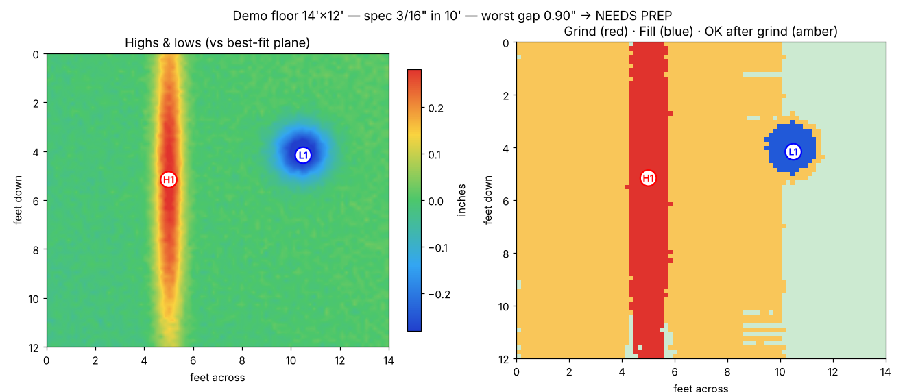

# Subfloor Mapper

An iOS app that maps a subfloor's high and low spots before laying luxury vinyl plank (LVP), checks
them against the flooring's flatness spec, and tells you what to grind and what to fill.



## Two ways to survey

| | LiDAR scan | Laser level grid |
|---|---|---|
| Device | iPhone 12 Pro or newer Pro / iPad Pro with LiDAR | Any iPhone or iPad |
| Speed | A few minutes per room | Slower: one reading per grid point |
| Accuracy | Coarser: good for finding problem areas | As good as your laser and tape |
| Best for | Fast triage, big rooms | Sign-off, borderline floors, warranty records |

**LiDAR scan:** hold the phone at about waist height, pointed down, and walk slowly in overlapping
passes. Every depth pixel that lands on the floor is projected into gravity-aligned world space and
averaged into 1" cells, so each cell ends up with dozens to hundreds of samples. A live mini-map shows
coverage and the worst gap so far. When you tap Done, the scan is squared up to the walls.

**Laser level grid:** pick a starting corner (A1), chalk a grid (2' is a good default), set up a
rotating or line laser, then at each point read the tape where the laser line crosses it. The app
walks you through the points in a back-and-forth order, takes job-site input like `1 3/16` or
`1-3/16`, and lets you skip points under cabinets and other obstacles.

## How the analysis works

All of it lives in `Packages/SubfloorCore`, a plain Swift package with no UIKit, so you can test it
on a Mac with `swift test`.

1. **Reference plane:** a least-squares plane is fitted to the floor, then refitted with outliers
   left out so one big hump can't tilt it. LVP needs a *flat* floor, not a *level* one, so highs and
   lows are measured from this plane. If the floor also has to be level, switch to **Level**.
2. **Straightedge simulation:** a virtual straightedge as long as the spec span (for example 10') is
   laid everywhere along rows, columns and both diagonals. At each placement it rests where gravity
   would put it, on the upper convex hull of the floor profile under its center, and the gap is
   measured along its full length.
3. **Grind:** the high points that failing straightedge placements rest on, along with the raised
   area connected to them, are marked red.
4. **Fill:** the straightedge check is run again as if the highs were ground down. Whatever still
   fails is marked blue. Amber areas fail today but only because a nearby hump makes the
   straightedge rock, so they'll pass once it's ground.
5. **Punch list:** grind and fill areas are grouped into numbered spots (H1, L1, …) with their
   height or depth, area and location, plus rough grinding and patch volumes.

Built-in specs: 3/16" in 10' (the most common for LVP), 1/8" in 6', 1/4" in 10', and 4 mm in 2 m.
Always check your flooring's installation guide.

## Build & run (Mac)

```bash
brew install xcodegen          # one-time
cd SubfloorMapper
xcodegen                       # generates SubfloorMapper.xcodeproj from project.yml
open SubfloorMapper.xcodeproj
```

In Xcode, choose your team under *Signing & Capabilities*, change the bundle ID
(`com.example.SubfloorMapper`) to your own, and run it on a real device. LiDAR scanning needs a
physical LiDAR device; the simulator can only use the laser-grid mode.

Run the analysis tests:

```bash
cd Packages/SubfloorCore && swift test
```

Requirements: Xcode 15+, iOS 17+.

## Exporting

The share button renders a PDF report with the verdict, both maps, the measurements and the punch
list, ready to send to a client or keep with the job file.

## Project layout

```
project.yml                       XcodeGen spec
Packages/SubfloorCore/            Analysis engine + unit tests (platform-independent)
  ElevationGrid.swift             Binning, IDW hole-filling, bilinear grid from manual readings
  FlatnessAnalyzer.swift          Plane fit, straightedge simulation, grind/fill classification
  ManualSurvey.swift              Laser-grid layout, node labels, walking order
  SurveyPoint.swift               LiDAR sample accumulator, wall alignment
  Units.swift                     Fractional-inch parsing and formatting
SubfloorMapper/
  Scanning/FloorScanner.swift     ARKit depth → floor heights
  Views/                          SwiftUI screens (list, scan, manual entry, results, PDF)
  Support/                        Heatmap rendering, analysis glue
```

## Limits

- LiDAR depth isn't survey-grade. Averaging removes most random noise, but tracking drift over a
  long scan and shiny or very dark floors can bias the result. Treat LiDAR as a way to find problem
  areas, and confirm anything borderline with a straightedge or the laser grid.
- Each scan has to cover the whole floor in one session, because separate scans can't be stitched
  together yet.
- Volume and bag counts are estimates. Patch yield varies a lot between products.
